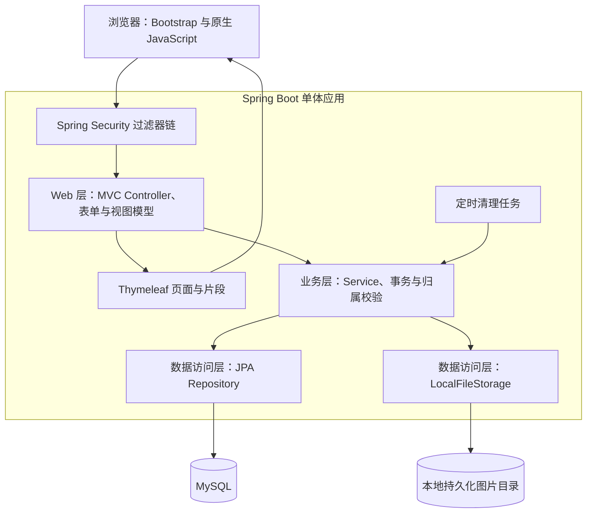
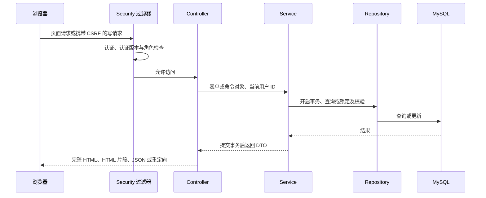
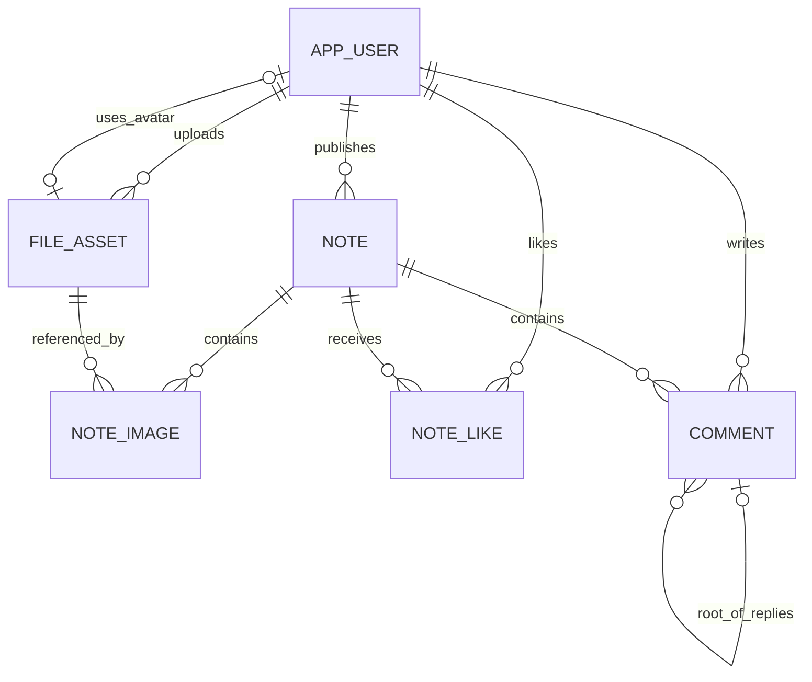
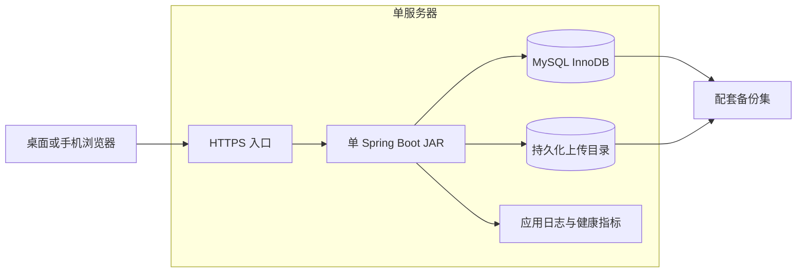

# Rednote v1.0.0 架构说明文档

| 项目 | 说明 |
| --- | --- |
| 文档日期 | 2026-10-18 |
| 需求基线 | [Rednote PRD](prd.md) |
| 适用范围 | 课程 Web 项目，单体、单服务器、单应用实例 |
| 文档状态 | 待实现架构；本文不代表相关功能已经实现 |
| 交付边界 | 架构与开发约定；当前实现及验证状态见 backend.md 和 backend-verification.md |

## 1. 架构目标与技术基线

### 1.1 设计目标

采用三层架构，在一个可执行 JAR 中完成用户端、后台管理、认证授权、图片访问和定时清理。优先保证 PRD 的业务一致性、可理解性与可测试性，满足 1 万篇有效笔记、20 个并发用户下常规查询 P95 不超过 1 秒的课程验收目标。

以下为已确认的技术选择：

| 领域 | 选择 | 职责 |
| --- | --- | --- |
| 页面 | Thymeleaf、Bootstrap、原生 JavaScript Fetch | 服务端渲染、响应式布局、局部交互 |
| 应用运行 | Spring Boot | 自动配置、内嵌 Web 容器、配置和生命周期管理 |
| Web | Spring MVC | 请求映射、绑定校验、页面及局部响应 |
| 安全 | Spring Security、服务器 Session | 登录、退出、认证状态、CSRF 与角色授权 |
| 业务 | Spring Service、声明式事务 | 用例编排、权限归属、状态转换与一致性 |
| 持久化 | Spring Data JPA、MySQL InnoDB | 业务数据、约束、查询和事务锁 |
| 图片 | 本地持久化目录、图片元数据 | 图片读写、引用保护和清理 |

首版不引入 Redis、消息队列、搜索引擎、微服务、共享存储或独立前端工程。数据库迁移采用 Flyway；MySQL 8.4 LTS、utf8mb4 作为实施默认基线，具体补丁版本在部署时固定并记录。Bootstrap 5.3 系列资源随应用提供，不依赖 CDN。

### 1.2 当前工程与兼容性结论

当前工程已经接入真实数据库与本地文件服务，preview 业务存储、安全配置和 profile 已移除。`DatabaseApplication` 适配现有页面接口，业务由独立 Service 处理，持久化使用 JPA Repository 和参数化查询。

实施使用 Java 17.0.14、Spring Boot 4.0.8、Spring Security 7.0.7、Hibernate 7.2.24.Final、Flyway 11.14.1、MySQL 8.4.8；已在独立 MySQL 执行 Flyway、JPA validate、HTTP 会话与 CSRF 测试。保留原技术基线，未升级或降级 Spring Boot。

页面以服务端显式 `me` 与权限展示字段控制按钮，实际权限仍由过滤器与 Service 校验。Thymeleaf 页面、匿名/用户/管理员访问均通过真实 HTTP 和浏览器验证；不以安全扩展 artifact 名称代替兼容性结论。

WebP 使用 TwelveMonkeys ImageIO 3.12.0，浏览器实际生成的 WebP 已通过上传解码及发布流程。图片解码同时受 4000 万像素和两路并发预算限制。

后续构建和验收继续使用 Java 17，不能因本机默认 Java 24 而变更目标运行时。运行与验收记录见 [backend.md](backend.md)、[backend-verification.md](backend-verification.md)。

## 2. 总体架构与分层职责

### 2.1 总体架构图



Spring MVC Controller 属于表现层；Spring Boot 是整体运行框架，不单独归入业务层。Spring Security 横跨请求安全和业务授权支持。Service 是业务逻辑的唯一编排入口，模板、Controller、清理任务均不直接操作 Repository 或文件路径。

| 层次 | 负责 | 不负责 |
| --- | --- | --- |
| Web 层 | 请求绑定、格式校验、提取认证主体、调用用例、选择页面或响应、错误映射 | 事务编排、直接查询数据库、拼接存储路径 |
| 业务层 | 业务校验、资源归属、事务、数据聚合、文件生命周期与授权访问判定 | Servlet 请求细节、模板渲染 |
| 数据访问层 | 实体映射、约束查询、锁查询、文件流读写与安全路径解析 | 决定某用户是否有权执行业务操作 |

服务端模板只消费完整视图模型。关闭 Open EntityManager in View，在 Service 的只读事务内完成 DTO 构造，防止模板隐式查询和懒加载异常。所有依赖通过构造器注入，避免循环调用；后台服务复用用户、统计等业务能力，不建立绕过权限规则的数据库入口。

### 2.2 推荐包结构

```text
com.shengid.rednote
├── RednoteApplication
├── config                 # Web、Security、JPA、调度与存储配置
├── security               # 认证主体、版本校验、登录和异常处理器
├── controller
│   ├── web                # 页面与 HTML 片段
│   └── action             # Fetch 的 JSON 与上传入口
├── service                # user、note、file、feed、like、comment、admin
├── repository             # JPA Repository 与查询实现
├── entity                 # 实体与持久化枚举
├── dto                    # form、view、response，按业务继续细分
├── storage                # FileStorage 接口、本地文件适配器
├── task                   # 调度入口，只调用 Service
└── exception              # 业务异常与统一映射

resources
├── templates              # layouts、fragments、auth、note、user、admin、error
├── static                 # css、js、vendor、默认头像
└── db/migration           # Flyway 版本化迁移
```

### 2.3 模块与需求映射

| 模块 | Service 职责 | PRD 关联 |
| --- | --- | --- |
| 用户 | 注册、资料、密码、公开主页 | USER-01～06 |
| 笔记 | 发布、详情、编辑、删除及图片引用变更 | NOTE-01～04 |
| 文件 | 上传、受控读取、删除申请、引用保护、清理 | FILE-01～04 |
| 首页搜索 | 卡片聚合、稳定游标与关键词查询 | HOME-01～03 |
| 点赞 | 设置已点赞／未点赞状态及准确计数 | LIKE-01～02 |
| 评论 | 两层关系、回复目标、删除与总数 | COMMENT-01～04 |
| 后台 | 用户筛选、禁用启用、看板聚合 | ADMIN-01～04 |

## 3. 页面交互与接口边界

### 3.1 请求与响应策略



- 完整页面由 Thymeleaf 渲染；注册、资料、密码和笔记普通表单成功后使用 POST → 303 → GET。校验失败回显字段与错误，不回显密码。
- 首页与搜索首批由整页渲染，后续通过 Fetch 获取 HTML 卡片片段；片段包装节点携带下一游标和是否结束标记。片段只渲染服务端安全模型，前端不拼接用户文本 HTML。
- 点赞、评论提交与删除、文件上传使用 JSON；评论成功响应返回安全的评论展示对象，前端通过 `textContent` 写入，必要时重新加载对应评论片段。
- 文件逐张 multipart 上传，单文件上限 10 MiB；请求整体上限建议 11 MiB，预留表单开销，避免恰好 10 MiB 的合法文件被误拒。批量选择也逐张请求，最多 9 张由业务再次校验。
- 静态资源和业务均同源，Fetch 显式按同源携带 Cookie，写请求附 CSRF 请求头。GET 不修改业务状态；退出使用 POST。

页面路径、动作路径与资源 ID 的命名在接口设计阶段确定；本文先固定契约职责，不定义所有 URL 和字段。首页卡片、详情、用户资料不得直接序列化 Entity，尤其不得携带密码摘要、存储物理路径、认证版本等内部字段。

### 3.2 分页、校验与错误约定

- 首页和搜索游标包含本次首批的笔记 ID 上界与最后一项的发布时间、ID；后续限定 ID 不超过首批上界，并按 `(publishedAt, id)` 严格向后查，确保后发布内容刷新后出现。游标须校验格式、范围且与关键词绑定，不作为授权凭据。
- 卡片每次读取 21 条判断是否还有数据，返回最多 20 条；删除导致后续页不足属正常情况，前端仍按 ID 去重。个人主页、后台用户列表采用从 0 开始的页码、固定 20 条；主评论和回复分别分页，按 PRD 的时间及 ID 排序。
- 表单格式由 Bean Validation 校验，Unicode 长度使用 code point 计数的自定义校验，不能直接用 UTF-16 长度代替。业务层再次校验合法图片、内容归属、目标有效性与账号状态。
- JSON 成功响应返回业务结果；失败统一包含错误码、用户提示、可选字段错误和请求追踪 ID。图片响应返回实际 Content-Type，不使用 JSON 包装文件流。
- HTTP 状态采用：400 参数不合法、401 未登录或失效、403 无权限或 CSRF 拒绝、404 内容不可用、409 状态冲突或版本冲突、413 请求超限、415 文件类型不支持、500 未预期异常。完整页面可显示对应错误页；普通表单校验失败返回表单页。
- Fetch 入口认证失败返回 401，不重定向成 200 登录 HTML；前端保留输入并显示登录入口。普通受限页面可跳转登录，成功后只恢复站内 GET 页面，禁止自动重放写请求与跳往外部地址。
- 禁用提交按钮并采用 PRG 防止常见重复提交；点赞有数据库幂等保障，笔记与评论创建结果未知时不自动重试。后续如需跨请求创建幂等，应另行增加请求键设计。

## 4. 认证、授权与会话失效

### 4.1 认证与基础防护

使用 Spring Security 表单登录，Session 仅存用户 ID、角色和登录时的 `authVersion` 等最小认证数据，不保存 JPA Entity。用户名先裁剪首尾空格并以 `Locale.ROOT` 规范化为小写进行唯一校验，保留展示用户名；密码不裁剪。

密码使用 Spring Security 的带算法标识 PasswordEncoder，首版选择框架提供的 PBKDF2-HMAC-SHA256 编码器，使用随机盐并显式固定参数，初始迭代次数为 600000、输出 256 位；在目标机器上测量登录耗时。避免 BCrypt 的输入字节上限与 PRD 的 Unicode 字符长度规则冲突，不静默截断密码。密码与摘要不记日志，参数升级通过编码标识及登录时重编码演进。

启用会话固定攻击防护、CSRF 和输出转义。模板默认使用转义输出，正文换行通过 CSS 展示，不使用 `th:utext` 渲染用户内容。Cookie 设置 HttpOnly、SameSite=Lax；正式 HTTPS 环境设置 Secure。Session 默认空闲 30 分钟失效，不启用 remember-me，重启后所有用户重新登录。认证相关响应与私有图片预览设置禁止缓存。

### 4.2 权限与认证版本

- 过滤器链对后台要求管理员，对写操作要求有效认证；业务 Service 从可信认证主体取得操作者 ID，不接受客户端声明作者 ID。
- 笔记、评论和文件在业务层逐项校验所有权；管理员不获得他人内容管理权。禁止禁用管理员，管理员创建只允许通过显式初始化流程。
- 用户持久化保存递增 `authVersion`。禁用和修改密码在事务中递增版本；Session 中的旧版本不再有效，启用不降低或恢复旧版本。
- 每次已认证请求读取当前用户状态和版本，不使用跨请求缓存；不匹配即清除认证并失效当前 Session。其他设备上的旧 Session 在下一次请求时同样无法认证，不依赖仅注销当前 Session。
- 所有写用例在事务中首先锁定操作者用户行，再验证状态与认证版本，持锁直到提交；管理员更改用户状态锁定管理员与目标用户，按用户 ID 升序。旧凭据登录与禁用／改密竞争时，登录完成前再次核对版本与状态。

**并发语义：**若某写事务先取得账号锁，它在禁用事务成功前完成；若禁用先提交，后续写入均拒绝。禁用返回成功时不存在仍可依据旧账号状态继续提交的业务写事务。文件落盘等外部工作结束后也须在元数据提交事务中重新校验，不能只在过滤器校验一次。

## 5. 核心数据关系与查询策略

### 5.1 逻辑关系



头像关联为用户上的可空文件 ID；一份文件可同时被头像及该上传者的多个笔记引用，关系图不表示跨所有者共享权限。评论统一一张表，根评论没有 `rootCommentId`；回复持有根评论 ID、目标评论 ID 和被回复用户 ID，层级始终为两层。删除目标回复后其记录保留，其他回复仍可读取被回复用户，但不提供跳转已删除内容的入口。

| 数据对象 | 必要状态与约束 |
| --- | --- |
| 用户 | 规范化用户名唯一，角色、账号状态、认证版本、密码摘要、头像引用、注册时间 |
| 笔记 | 作者、标题正文、不可变发布时间、更新时间、删除时间、乐观版本号 |
| 图片 | 上传者、生成的存储键、实际类型、字节数、生命周期状态、无引用起始时间 |
| 笔记图片 | 笔记和图片关系及顺序；同一笔记图片唯一，顺序唯一 |
| 点赞 | 用户与笔记联合唯一；取消时物理删除该点赞关系，允许重新插入 |
| 评论 | 作者、笔记、根评论、回复目标和被回复用户、内容、创建与删除时间 |

数据库使用外键与唯一约束保护关系。笔记和评论逻辑删除；删除根评论同步标记其全部回复，删除笔记同步标记其评论并移除点赞与图片关联。历史笔记行和发布时间保留，历史发布趋势不受后续删除影响。头像与笔记图片只允许引用 READY 状态且归属当前用户的文件。

### 5.2 时间、统计与索引

- 数据库存储 UTC 时间，应用用可注入 Clock 获取时间；看板按 Asia/Shanghai 构造自然日边界后转 UTC 查询，不能依赖操作系统或数据库默认时区。
- 有效笔记排除已删除行；有效评论同时要求自身、根评论和笔记有效；点赞计数只关联有效笔记。禁用作者的历史公开数据继续计入。
- 首版不维护冗余点赞／评论计数列，使用聚合查询；一批卡片以批量聚合获取数量与本人点赞集合，避免每卡查询。详情图片单独按顺序查询，分页查询不对集合做 fetch join。
- 索引至少覆盖笔记删除状态与发布时间、作者与发布时间、点赞笔记 ID 及用户笔记唯一键、评论笔记／根评论与创建时间、文件状态与无引用时间、用户规范化用户名唯一键和注册时间。具体顺序通过真实 MySQL 执行计划验证。
- 标题与正文使用参数化包含匹配，转义 `%`、`_` 和转义字符，明确采用对英文大小写不敏感的排序规则。包含匹配不声称可通过普通 B-tree 索引消除扫描，按 1 万篇数据实测，不预先引入搜索引擎。
- 看板在同一只读一致性事务中计算总量与最近 7 天趋势，无数据日期由 Service 补零；普通注册用户排除管理员，发布趋势不排除后续删除笔记，返回统计时间与口径说明。

## 6. 事务边界与并发约束

### 6.1 统一锁顺序

涉及写入时采用 MySQL 行锁，JPA 通过显式悲观锁查询执行；所有用例统一遵守以下顺序，并在同类资源内按 ID 升序：

**用户 → 笔记 → 评论 → 文件元数据。**

实施补充：回复插入会对 reply_to_user_id 触发外键用户锁，因此回复须在锁笔记前按 ID 升序锁定操作者及被回复用户。目标定位使用标量投影，取得笔记及评论锁后重新校验有效性；评论写事务采用 READ COMMITTED，避免旧快照与额外间隙锁。


允许跳过不需要的层级，禁止取得文件锁后再回头申请笔记或用户锁。定时清理只锁文件，不申请上游业务锁。批量场景先确定资源集合后有序锁定；锁超时或死锁回滚并返回可识别冲突，不自动重放创建操作。

### 6.2 关键事务

| 场景 | 事务与冲突处理 | PRD 关联 |
| --- | --- | --- |
| 发布笔记 | 锁操作者、锁全部目标图片，验证 READY 与所有权，再整体写入笔记和图片关系，更新无引用状态 | NOTE-01、FILE-02 |
| 编辑笔记 | 锁操作者及笔记，核对提交版本，锁新旧图片并整体替换关系；版本过期返回 409，原版本不被覆盖 | NOTE-03、NFR-02 |
| 删除笔记 | 锁操作者与笔记，逻辑删除、评论失效、点赞删除与图片解除引用在同一事务完成 | NOTE-04 |
| 点赞和取消 | 锁操作者与笔记，确认有效后检查并设置目标状态；唯一键兜底，并发重复请求不会增加多条或负计数 | LIKE-01～02 |
| 评论及回复 | 锁操作者与笔记，再按 ID 有序锁根评论及回复目标，检查同属该笔记且有效后插入 | COMMENT-01～02 |
| 删除评论 | 锁操作者、所属笔记与目标评论；删除根评论时同事务使全部回复失效；删除回复只标记自身 | COMMENT-03～04 |
| 修改头像 | 锁用户、按 ID 锁新旧文件，更新头像及引用生命周期，提交成功后才展示新头像 | USER-04、FILE-03 |
| 禁用与改密 | 锁相应用户，变更状态／摘要及认证版本；提交后旧认证无法再写入 | PERM-02、USER-05 |

同一笔记的互动与删除先锁同一笔记行，形成明确先后顺序，首版接受热点笔记写操作串行的吞吐代价。若删除先完成，后来的点赞或回复返回内容不可用；若互动先提交，删除事务会将其一并失效。

事务注解放在可被代理调用的 Service 公共方法上，避免类内调用导致事务失效。文件传输、图片解码和长时间磁盘操作不放在数据库锁事务内。异常整体回滚，异步或提交后回调不作为唯一可靠清理机制。

## 7. 本地图片存储与生命周期

### 7.1 存储与读取边界

上传根目录使用外部绝对路径，例如 `/var/lib/rednote/uploads`，与 JAR、源码和静态资源目录分离。存储键由服务器生成，不使用客户端文件名构造路径；归一化路径后校验仍位于根目录内，禁止跟随指向目录外的符号链接。

图片访问经 Controller → FileService → FileStorage，返回文件流。文件处于 READY 且被有效公开笔记或头像引用时，游客可访问；未引用图片仅上传者可预览；待删除或已删除文件不可读取。不得将整个上传目录直接映射成公开静态目录。

文件内容校验包括实际类型、字节数和可解码性；先读取尺寸元数据评估资源消耗，解码置于有并发与内存预算限制的处理流程，禁止不受限地分配像素缓冲区。经 2026-10-18 需求确认，单张最多 4000 万像素，同时最多解码两张；超出像素限制返回明确错误，等待解码资源超过 10 秒返回可重试冲突。类型与解码均通过后保存；输出实际 MIME 与 `nosniff`，文件不作为 HTML 执行。首版图片访问统一使用 `Cache-Control: no-store`，避免权限撤回后缓存继续作为公开入口。

### 7.2 状态与上传流程

文件生命周期状态为 `STAGING → READY → DELETING → DELETED`，失败清理保留 `DELETING` 重试；STAGING 不可被业务引用。

1. 上传请求通过认证及大小限制后，写入生成键对应的临时文件，完成类型、尺寸和解码校验；失败立即尽力删除临时文件。
2. 短事务锁操作者、复核账号版本，登记 STAGING 元数据及上传者；登记失败则补偿删除临时文件。
3. 将临时文件移动到最终位置，临时与正式目录位于同一文件系统；优先使用原子移动。移动失败保留可回收状态，不返回上传成功。
4. 新事务重新校验账号，锁元数据，确认目标文件存在后标记 READY，设置无引用起始时间，再返回图片 ID 与受控访问地址。禁用或故障导致此步失败时，文件不能被引用，由回收任务处理。

数据库事务不能回滚物理文件操作。STAGING 超过 1 小时且无活跃上传任务时回收，不自动对外发布。对无元数据文件和未完成临时文件扫描，至少等待 24 小时安全窗口、再次查库并确认无活跃上传后删除；扫描失败记录并重试，数据库不可用时禁止按“无引用”删除。

### 7.3 引用变更与删除流程

- 引用以用户头像与有效笔记图片关系的实际存在为准，不单独依赖内存或容易漂移的引用计数。
- 文件有引用时 `unreferencedSince` 为空；新上传无引用时取上传成功时间；最后一个引用解除时取解除时间。重新被引用后清空该时间；取消编辑不变更已发布关系，新上传图片仍按无引用规则处理。
- 每小时执行分批清理，对无引用满 24 小时的 READY 候选逐条加文件锁，重新查询有效引用，再提交 DELETING 状态。关联操作也必须先锁文件并验证 READY，因此无法引用已进入删除流程的文件。
- 用户主动删除需校验上传者且无引用，采用同样状态机，不要求等待 24 小时；重复删除目标状态幂等。删除申请后该文件立即不可访问，物理删除失败显示“清理中”并留待重试。
- 提交 DELETING 后执行物理删除；成功或文件已不存在，再标记 DELETED。崩溃发生在任一步，下一轮扫描 DELETING 可继续执行；即使不满 24 小时也应重试此类已确认删除的文件。
- 清理目标为无故障条件下无引用满 25 小时前删除；超时、磁盘错误或积压需记录告警，不能以故障为由误删引用文件。文件访问和删除的流处理在存储适配器内协调，已打开的读取可完成，新读取在 DELETING 后拒绝。

## 8. 部署、配置与运维

### 8.1 单机部署



HTTPS 可由受控反向代理终止，应用使用非 root 系统账户作为系统服务运行；MySQL 仅允许本地或私有连接。反向代理须透传受信协议和来源信息，并设置大于应用请求上限的上传限制。开发环境可使用本机 HTTP，部署环境必须开启 Secure Cookie。

内存 Session 不跨重启保存，上传目录必须跨版本发布保留。首版定时任务仅单实例运行；扩展多实例前，必须重新设计共享会话或认证机制、文件共享访问、定时任务互斥和备份协调，不能仅增加 JAR 实例数。

### 8.2 配置与数据库变更

| 配置类别 | 约定 |
| --- | --- |
| 环境 | dev、test、prod 分环境；密码和管理员初始凭据通过环境或受限配置注入，不入库公开源码 |
| 数据库 | URL、用户名、密码、连接池、UTC 会话时区；所有环境采用 utf8mb4 |
| JPA | 关闭 Open-in-View，部署使用 ddl-auto=validate；禁止自动更新替代迁移 |
| 迁移 | Flyway 管理结构和索引，新增版本不修改已执行迁移；启动校验失败则停止服务 |
| 上传 | 根路径、10 MiB 文件限制、11 MiB 请求限制、解码资源预算、清理周期和时限 |
| Session | 空闲超时、Cookie、安全代理配置，不启用持久化会话 |
| 日志指标 | 日志等级、滚动保留、请求追踪、健康端点访问范围 |

管理员使用显式启用的一次性初始化命令或配置创建，要求传入凭据，以相同密码编码器保存；不存在才创建，重复执行不能重置密码或将普通用户升级。不要在每次启动时设置默认管理员密码。

### 8.3 日志、健康与备份

- 记录请求 ID、业务对象 ID、执行结果、耗时、清理重试和异常，后台状态变更记录操作者与目标；不记录密码、Cookie、令牌、完整请求正文或数据库密钥。
- Actuator 仅暴露必要健康信息，详情和指标仅管理员或运维网络可访问；监控数据库连通、上传目录可写性、磁盘余量、清理积压及错误率。
- 每日配套备份数据库和图片，默认保留最近 7 份。课程部署采用维护窗口：停止写请求、等待在途写入和上传完成、暂停清理，再生成数据库备份与上传目录快照，记录统一备份编号与迁移版本。
- 恢复时保持应用停止，将同一备份集的数据库及文件一起恢复，核对图片引用与文件存在性，验证版本后启动；不混用不同日期的数据和图片。备份失败须明确记录，至少演练一次完整恢复。

## 9. 验证方案与架构验收

| 测试层次 | 重点与预期结果 | PRD 对应 |
| --- | --- | --- |
| 单元测试 | Unicode 长度、用户名规范化、回复层级、时区边界、文件状态及指标口径 | AC-01、11、19 |
| MVC／安全测试 | 匿名与角色授权、所有权、CSRF、错误状态、退出、模板转义、JSON 不返回 Entity | AC-02、06、16、20 |
| 真实 MySQL 集成 | 使用隔离 MySQL 8.4 实例或 Testcontainers，验证迁移、唯一键、悲观锁、事务回滚和逻辑删除过滤；不以 H2 结果代替 | AC-07、10、12、17、18、21 |
| 文件集成 | 临时目录测试类型解码、恰好 10 MiB、损坏 WebP、所有权、访问控制与引用保护 | AC-14、15 |
| 故障与并发 | 用同步屏障构造竞争，验证下列关键场景及磁盘故障补偿，不只验证串行结果 | AC-07、13、15、17、21 |
| 浏览器端到端 | 注册、登录、发布编辑、搜索滚动、点赞评论、后台用户管理；1440 px 与 375 px | AC-01～20 |
| 性能与恢复 | 1 万篇笔记、20 并发、代表性互动数据，预热后稳定负载至少 5 分钟，记录硬件、执行计划与 P95；演练配套备份恢复 | NFR-03～05 |

必须覆盖的竞争与故障场景：

1. 同一用户重复或并发点赞只存在一条关系，重复取消保持零条。
2. 笔记删除与点赞／评论并发，删除成功后没有有效残留；根评论删除与回复竞争时，回复失败或随根评论失效。
3. 两个设备登录后禁用或改密，两个旧会话均失效；暂停写事务并执行禁用，确认禁用返回时旧权限写事务已提交或被拒绝。
4. 清理与重新关联同一图片竞争，要么关联成功并保留文件，要么清理先标记后关联失败；共享图片移除单一引用不误删。
5. 在落盘后登记失败、标记删除后进程退出、物理删除失败、清理期间数据库不可用等故障中验证补偿和可恢复性。
6. 相同发布时间、滚动期间新增或删除笔记、关键词包含 `%` 与 `_`、北京时间午夜边界均符合 PRD。

文档验收要求：七大业务模块均可定位到组件；关键一致性方案能够落到数据库锁或约束；安全、文件和统计规则不与 PRD 冲突；当前工程现状与待实现方案明确区分。依赖验证、性能目标及恢复能力必须以执行记录确认，本文本身不构成通过证明。

## 10. 实施顺序与后续演进

1. 完成依赖兼容性验证、数据库迁移、安全骨架和测试环境。
2. 实现用户与文件生命周期，再实现笔记、首页与搜索。
3. 实现点赞评论与并发约束，随后实现后台和统计。
4. 完成端到端、性能、安全与备份恢复验收，再交付演示环境。

本架构中的事务锁粒度、包含搜索和本地存储适用于当前课程规模。只有实测容量或部署需求变化时，再评估缓存、搜索服务、对象存储和多实例；届时保持 Controller／Service 边界，通过替换存储适配器及查询实现演进，不提前拆分微服务。
