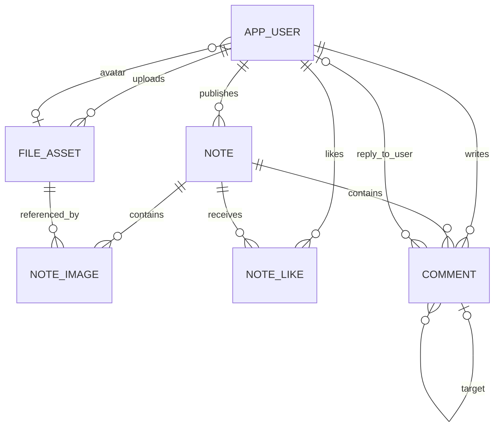

# Rednote v1.0 数据库设计

| 项目 | 约定 |
| --- | --- |
| 日期 | 2026-10-18 |
| 需求依据 | [PRD](prd.md)、[架构说明](arch.md)、[前端接口契约](frontend.md) |
| 数据库 | MySQL 8.4 LTS、InnoDB、utf8mb4 |
| 应用形态 | Spring Data JPA，单体、单服务器、单实例 |
| 状态 | 待实施设计；DDL 和查询示例未在真实 MySQL 执行验收 |
| 交付范围 | 六张业务表、DDL、查询与一致性约定；不修改业务代码或数据库 |

## 1. 设计基线

PRD 决定业务行为，架构决定事务与存储边界，前端契约决定命令及展示映射。当前已有 Thymeleaf 页面、接口和 `preview` 内存适配器，但没有生产持久化实现；架构文档中“仅有初始化工程”的描述是早期快照。内存数据不作为生产数据迁移来源，预览账号及静态图片不直接写入生产库。

首版不建关注、收藏、通知、审核、草稿、Session 或统计快照表，不保存冗余点赞数、评论数、图片引用数。管理员状态变更记录在应用审计日志中，包含操作者、目标、前后状态、时间和结果，不另建审计业务表。

### 1.1 通用约定

- 表名、列名采用小写 snake_case。实体表使用有符号 `BIGINT AUTO_INCREMENT` 主键，对应 Java `Long`；点赞使用复合主键，无独立 ID。ID 只取正值，不要求连续，不承担权限校验。
- 时间统一为 `DATETIME(6)`，语义为 UTC；由 Service 使用可注入 `Clock` 写入，不使用数据库自动更新时间。数据库连接会话时区固定 `+00:00`，Hibernate JDBC 时区为 UTC；Java 业务使用 `Instant`，映射必须在真实 MySQL 验证微秒精度及往返时区。
- 普通用户文本使用 `utf8mb4_0900_as_ci`，英文忽略大小写、重音敏感。规范化用户名和机器字段使用二进制排序规则，避免唯一性依赖语言排序。所有环境启用严格 SQL 模式，拒绝截断和非法值。
- `VARCHAR(n)` 的 n 是数据库字符数，不是字节数。应用按 Unicode code point 做 trim 后长度校验，数据库 `CHAR_LENGTH` 作长度兜底；密码不 trim。数据库不代替应用检查纯空白、用户名格式或密码复杂度。
- 所有外键采用 `RESTRICT`，不使用物理级联删除或触发器。业务删除通过 Service 的同一事务显式完成。用户不提供删除功能；笔记、评论和文件元数据保留历史行。
- 可空字段仅用于明确的缺失状态；简介默认空字符串，默认头像由应用静态资源提供，数据库保存 NULL。

## 2. 实体关系与字段字典



图表示外键基数，不表示所有组合均合法。例如图片只能由上传者本人关联；一个文件允许同时用于本人头像和多篇本人笔记。评论根与目标关系由业务进一步限制为两层。

以下字段的类型、默认值与可空性以第 3 节 DDL 为准。

### 2.1 用户 app_user

| 字段 | 类型 / 可空 / 默认 | 含义 |
| --- | --- | --- |
| id | BIGINT / 否 / 自增 | 用户 ID |
| username | VARCHAR(20) / 否 / 无 | trim 后保留注册大小写的用户名，只读 |
| username_normalized | VARCHAR(20) / 否 / 无 | `Locale.ROOT` 小写，唯一，ASCII 格式 |
| password_hash | VARCHAR(255) / 否 / 无 | 带算法标识的密码摘要，禁止返回或记录日志 |
| nickname | VARCHAR(20) / 否 / 无 | 昵称，不唯一；注册默认取用户名 |
| bio | VARCHAR(200) / 否 / 空字符串 | 简介 |
| avatar_file_id | BIGINT / 是 / NULL | 当前头像文件；NULL 使用默认头像 |
| role | VARCHAR(16) / 否 / USER | USER、ADMIN |
| status | VARCHAR(16) / 否 / ACTIVE | ACTIVE、DISABLED；管理员只能 ACTIVE |
| auth_version | BIGINT / 否 / 0 | 禁用和改密时递增的认证版本 |
| created_at | DATETIME(6) / 否 / 无 | 注册时间，不可变 |
| updated_at | DATETIME(6) / 否 / 无 | 资料、密码或状态最后变更时间 |

密码按架构使用带算法标识的 PBKDF2-HMAC-SHA256 编码结果；确认密码和旧密码不入库。用户名规范化后判重，由唯一键处理注册竞争。所有公开作者信息实时关联用户，不保存昵称或头像快照。

### 2.2 笔记 note

| 字段 | 类型 / 可空 / 默认 | 含义 |
| --- | --- | --- |
| id | BIGINT / 否 / 自增 | 笔记 ID |
| author_id | BIGINT / 否 / 无 | 作者 |
| title | VARCHAR(50) / 否 / 无 | 1–50 字标题 |
| body | TEXT / 否 / 无 | 1–5000 字正文，保留内部换行 |
| published_at | DATETIME(6) / 否 / 无 | 成功发布时写入，编辑、删除均不改变 |
| updated_at | DATETIME(6) / 否 / 无 | 首次等于发布时间，编辑、删除时更新 |
| deleted_at | DATETIME(6) / 是 / NULL | NULL 表示有效 |
| version | BIGINT / 否 / 0 | JPA 乐观版本，对应编辑提交版本 |

不单存封面 ID，读取顺序为 1 的图片。保留删除后的行以计算历史每日发布数；没有公开/私密状态列，所有有效笔记立即公开。

### 2.3 文件 file_asset

| 字段 | 类型 / 可空 / 默认 | 含义 |
| --- | --- | --- |
| id | BIGINT / 否 / 自增 | 图片标识 |
| uploader_id | BIGINT / 否 / 无 | 上传者 |
| storage_key | VARCHAR(128) / 否 / 无 | 服务端随机生成的唯一存储键，非原文件名 |
| mime_type | VARCHAR(32) / 否 / 无 | 实际 image/jpeg、image/png、image/webp |
| size_bytes | BIGINT / 否 / 无 | 实际大小，1–10485760 字节 |
| width、height | INT / 否 / 无 | 解码确认的正整数尺寸 |
| state | VARCHAR(16) / 否 / STAGING | STAGING、READY、DELETING、DELETED |
| created_at | DATETIME(6) / 否 / 无 | 登记 STAGING 的时间 |
| ready_at | DATETIME(6) / 是 / NULL | 上传最终成功时间；失败上传可一直为空 |
| unreferenced_since | DATETIME(6) / 是 / NULL | READY 连续无引用起始时间；有引用时为空 |
| updated_at | DATETIME(6) / 否 / 无 | 最近状态或引用生命周期变更时间 |
| deleted_at | DATETIME(6) / 是 / NULL | 物理文件确认删除的时间 |

不保存绝对路径、展示 URL、文件二进制或客户端原文件名。存储适配器根据 storage_key 推导临时和正式路径。尺寸仅作为元数据和布局依据，不新增产品像素上限。DELETING 表示已撤销访问且等待物理删除，可直接重试，不重新等待 24 小时。

### 2.4 笔记图片 note_image

| 字段 | 类型 / 可空 / 默认 | 含义 |
| --- | --- | --- |
| id | BIGINT / 否 / 自增 | 关系 ID，便于 JPA 映射 |
| note_id | BIGINT / 否 / 无 | 笔记 |
| file_id | BIGINT / 否 / 无 | 图片文件 |
| sort_order | TINYINT / 否 / 无 | 1–9，连续排列，1 为封面 |

同篇 `(note_id, file_id)` 与 `(note_id, sort_order)` 分别唯一。一个文件可关联多篇本人笔记。删除笔记时物理删除图片关系，编辑失败时原关系随事务回滚恢复。

### 2.5 点赞 note_like

| 字段 | 类型 / 可空 / 默认 | 含义 |
| --- | --- | --- |
| user_id | BIGINT / 否 / 无 | 点赞用户，复合主键第一列 |
| note_id | BIGINT / 否 / 无 | 笔记，复合主键第二列 |
| created_at | DATETIME(6) / 否 / 无 | 本次点赞时间，重新点赞时重新生成 |

取消点赞物理删除。笔记删除时删除全部点赞关系；没有取消状态或历史点赞趋势需求。

### 2.6 评论 comment

| 字段 | 类型 / 可空 / 默认 | 含义 |
| --- | --- | --- |
| id | BIGINT / 否 / 自增 | 评论 ID |
| note_id | BIGINT / 否 / 无 | 所属笔记 |
| author_id | BIGINT / 否 / 无 | 评论作者 |
| root_comment_id | BIGINT / 是 / NULL | 主评论为空；回复始终指向主评论 |
| target_comment_id | BIGINT / 是 / NULL | 主评论为空；回复指向用户实际选择的主评论或回复 |
| reply_to_user_id | BIGINT / 是 / NULL | 主评论为空；回复目标作者 ID |
| content | VARCHAR(500) / 否 / 无 | 1–500 字纯文本，保留内部换行 |
| created_at | DATETIME(6) / 否 / 无 | 创建时间 |
| deleted_at | DATETIME(6) / 是 / NULL | 逻辑删除时间 |

三个回复字段须同时为空或同时非空。回复目标必须与本条同属笔记及根评论，且创建时有效；目标作者就是 reply_to_user_id。删除回复保留记录及作者关系，因此其他回复仍可读取最新目标昵称。删除根评论同步标记所有回复；删除笔记同步标记全部评论。有效评论查询同时检查笔记、自身与根评论有效性。

## 3. 完整建表 SQL

下列为未来 `V1__initial_schema.sql` 的结构设计。由部署流程预建数据库并授予最小权限，Flyway 在所选库执行，不将管理员明文凭据写入迁移。DDL 不含 `IF NOT EXISTS`，避免掩盖结构漂移；先建无头像外键的用户表，再建文件表，最后补头像外键。

```sql
CREATE TABLE app_user (
    id BIGINT NOT NULL AUTO_INCREMENT,
    username VARCHAR(20) NOT NULL,
    username_normalized VARCHAR(20) COLLATE utf8mb4_0900_bin NOT NULL,
    password_hash VARCHAR(255) COLLATE utf8mb4_0900_bin NOT NULL,
    nickname VARCHAR(20) NOT NULL,
    bio VARCHAR(200) NOT NULL DEFAULT '',
    avatar_file_id BIGINT NULL,
    role VARCHAR(16) COLLATE utf8mb4_0900_bin NOT NULL DEFAULT 'USER',
    status VARCHAR(16) COLLATE utf8mb4_0900_bin NOT NULL DEFAULT 'ACTIVE',
    auth_version BIGINT NOT NULL DEFAULT 0,
    created_at DATETIME(6) NOT NULL,
    updated_at DATETIME(6) NOT NULL,
    PRIMARY KEY (id),
    UNIQUE KEY uk_user_username_normalized (username_normalized),
    KEY idx_user_created (created_at DESC, id DESC),
    KEY idx_user_role_created (role, created_at, id),
    KEY idx_user_status_created (status, created_at DESC, id DESC),
    KEY idx_user_avatar (avatar_file_id),
    CONSTRAINT ck_user_username_length CHECK (CHAR_LENGTH(username) BETWEEN 4 AND 20),
    CONSTRAINT ck_user_normalized_length CHECK (CHAR_LENGTH(username_normalized) BETWEEN 4 AND 20),
    CONSTRAINT ck_user_nickname CHECK (CHAR_LENGTH(nickname) BETWEEN 1 AND 20),
    CONSTRAINT ck_user_role CHECK (role IN ('USER', 'ADMIN')),
    CONSTRAINT ck_user_status CHECK (status IN ('ACTIVE', 'DISABLED')),
    CONSTRAINT ck_user_admin_active CHECK (role <> 'ADMIN' OR status = 'ACTIVE'),
    CONSTRAINT ck_user_auth_version CHECK (auth_version >= 0)
) ENGINE=InnoDB DEFAULT CHARSET=utf8mb4 COLLATE=utf8mb4_0900_as_ci;

CREATE TABLE file_asset (
    id BIGINT NOT NULL AUTO_INCREMENT,
    uploader_id BIGINT NOT NULL,
    storage_key VARCHAR(128) COLLATE utf8mb4_0900_bin NOT NULL,
    mime_type VARCHAR(32) COLLATE utf8mb4_0900_bin NOT NULL,
    size_bytes BIGINT NOT NULL,
    width INT NOT NULL,
    height INT NOT NULL,
    state VARCHAR(16) COLLATE utf8mb4_0900_bin NOT NULL DEFAULT 'STAGING',
    created_at DATETIME(6) NOT NULL,
    ready_at DATETIME(6) NULL,
    unreferenced_since DATETIME(6) NULL,
    updated_at DATETIME(6) NOT NULL,
    deleted_at DATETIME(6) NULL,
    PRIMARY KEY (id),
    UNIQUE KEY uk_file_storage_key (storage_key),
    KEY idx_file_uploader (uploader_id, id),
    KEY idx_file_cleanup (state, unreferenced_since, id),
    KEY idx_file_staging (state, created_at, id),
    CONSTRAINT fk_file_uploader FOREIGN KEY (uploader_id) REFERENCES app_user (id)
        ON DELETE RESTRICT ON UPDATE RESTRICT,
    CONSTRAINT ck_file_size CHECK (size_bytes BETWEEN 1 AND 10485760),
    CONSTRAINT ck_file_dimensions CHECK (width > 0 AND height > 0),
    CONSTRAINT ck_file_mime CHECK (mime_type IN ('image/jpeg', 'image/png', 'image/webp')),
    CONSTRAINT ck_file_state CHECK (state IN ('STAGING', 'READY', 'DELETING', 'DELETED')),
    CONSTRAINT ck_file_ready CHECK (state <> 'READY' OR ready_at IS NOT NULL),
    CONSTRAINT ck_file_deleted CHECK (
        (state = 'DELETED' AND deleted_at IS NOT NULL)
        OR (state <> 'DELETED' AND deleted_at IS NULL))
) ENGINE=InnoDB DEFAULT CHARSET=utf8mb4 COLLATE=utf8mb4_0900_as_ci;

ALTER TABLE app_user ADD CONSTRAINT fk_user_avatar
    FOREIGN KEY (avatar_file_id) REFERENCES file_asset (id)
    ON DELETE RESTRICT ON UPDATE RESTRICT;

CREATE TABLE note (
    id BIGINT NOT NULL AUTO_INCREMENT,
    author_id BIGINT NOT NULL,
    title VARCHAR(50) NOT NULL,
    body TEXT NOT NULL,
    published_at DATETIME(6) NOT NULL,
    updated_at DATETIME(6) NOT NULL,
    deleted_at DATETIME(6) NULL,
    version BIGINT NOT NULL DEFAULT 0,
    PRIMARY KEY (id),
    KEY idx_note_feed (deleted_at, published_at DESC, id DESC),
    KEY idx_note_author (author_id, deleted_at, published_at DESC, id DESC),
    KEY idx_note_published (published_at, id),
    CONSTRAINT fk_note_author FOREIGN KEY (author_id) REFERENCES app_user (id)
        ON DELETE RESTRICT ON UPDATE RESTRICT,
    CONSTRAINT ck_note_title CHECK (CHAR_LENGTH(title) BETWEEN 1 AND 50),
    CONSTRAINT ck_note_body CHECK (CHAR_LENGTH(body) BETWEEN 1 AND 5000),
    CONSTRAINT ck_note_version CHECK (version >= 0)
) ENGINE=InnoDB DEFAULT CHARSET=utf8mb4 COLLATE=utf8mb4_0900_as_ci;

CREATE TABLE note_image (
    id BIGINT NOT NULL AUTO_INCREMENT,
    note_id BIGINT NOT NULL,
    file_id BIGINT NOT NULL,
    sort_order TINYINT NOT NULL,
    PRIMARY KEY (id),
    UNIQUE KEY uk_note_image_file (note_id, file_id),
    UNIQUE KEY uk_note_image_order (note_id, sort_order),
    KEY idx_note_image_file (file_id, note_id),
    CONSTRAINT fk_note_image_note FOREIGN KEY (note_id) REFERENCES note (id)
        ON DELETE RESTRICT ON UPDATE RESTRICT,
    CONSTRAINT fk_note_image_file FOREIGN KEY (file_id) REFERENCES file_asset (id)
        ON DELETE RESTRICT ON UPDATE RESTRICT,
    CONSTRAINT ck_note_image_order CHECK (sort_order BETWEEN 1 AND 9)
) ENGINE=InnoDB DEFAULT CHARSET=utf8mb4 COLLATE=utf8mb4_0900_as_ci;

CREATE TABLE note_like (
    user_id BIGINT NOT NULL,
    note_id BIGINT NOT NULL,
    created_at DATETIME(6) NOT NULL,
    PRIMARY KEY (user_id, note_id),
    KEY idx_note_like_note (note_id, user_id),
    CONSTRAINT fk_note_like_user FOREIGN KEY (user_id) REFERENCES app_user (id)
        ON DELETE RESTRICT ON UPDATE RESTRICT,
    CONSTRAINT fk_note_like_note FOREIGN KEY (note_id) REFERENCES note (id)
        ON DELETE RESTRICT ON UPDATE RESTRICT
) ENGINE=InnoDB DEFAULT CHARSET=utf8mb4 COLLATE=utf8mb4_0900_as_ci;

CREATE TABLE `comment` (
    id BIGINT NOT NULL AUTO_INCREMENT,
    note_id BIGINT NOT NULL,
    author_id BIGINT NOT NULL,
    root_comment_id BIGINT NULL,
    target_comment_id BIGINT NULL,
    reply_to_user_id BIGINT NULL,
    content VARCHAR(500) NOT NULL,
    created_at DATETIME(6) NOT NULL,
    deleted_at DATETIME(6) NULL,
    PRIMARY KEY (id),
    KEY idx_comment_page (note_id, root_comment_id, deleted_at, created_at, id),
    KEY idx_comment_root (root_comment_id, id),
    KEY idx_comment_target (target_comment_id),
    KEY idx_comment_author (author_id),
    KEY idx_comment_reply_user (reply_to_user_id),
    CONSTRAINT fk_comment_note FOREIGN KEY (note_id) REFERENCES note (id)
        ON DELETE RESTRICT ON UPDATE RESTRICT,
    CONSTRAINT fk_comment_author FOREIGN KEY (author_id) REFERENCES app_user (id)
        ON DELETE RESTRICT ON UPDATE RESTRICT,
    CONSTRAINT fk_comment_root FOREIGN KEY (root_comment_id) REFERENCES `comment` (id)
        ON DELETE RESTRICT ON UPDATE RESTRICT,
    CONSTRAINT fk_comment_target FOREIGN KEY (target_comment_id) REFERENCES `comment` (id)
        ON DELETE RESTRICT ON UPDATE RESTRICT,
    CONSTRAINT fk_comment_reply_user FOREIGN KEY (reply_to_user_id) REFERENCES app_user (id)
        ON DELETE RESTRICT ON UPDATE RESTRICT,
    CONSTRAINT ck_comment_content CHECK (CHAR_LENGTH(content) BETWEEN 1 AND 500),
    CONSTRAINT ck_comment_shape CHECK (
        (root_comment_id IS NULL AND target_comment_id IS NULL AND reply_to_user_id IS NULL)
        OR (root_comment_id IS NOT NULL AND target_comment_id IS NOT NULL
            AND reply_to_user_id IS NOT NULL))
) ENGINE=InnoDB DEFAULT CHARSET=utf8mb4 COLLATE=utf8mb4_0900_as_ci;
```

### 3.1 约束责任边界

数据库保障外键存在、枚举范围、长度上限、图片顺序范围、关系唯一性及评论字段空值组合。以下必须由 Service 在锁事务内校验：

- 用户名格式、小写规范化与展示值一致，昵称等字段 trim 后非空；密码复杂度与旧密码校验。
- 每篇 1–9 张图片且顺序连续；头像和笔记图片属于操作者、状态 READY；跨头像与多篇笔记的实际引用状态。
- 评论根确为主评论，目标与根和当前评论同属笔记，reply_to_user_id 与目标作者一致；禁止自引用或第三层根关系。
- 只有有效笔记可互动，只有有效根评论和目标可回复；拥有者权限、认证版本及所有状态转换。

普通外键不能表达“被引用对象未逻辑删除”，CHECK 不能查询其他行。禁止声称仅靠 DDL 就能保证这些跨行规则。

### 3.2 JPA 实施映射

实体 ID 使用 `GenerationType.IDENTITY`；`note_like` 使用 `@EmbeddedId` 与 `@MapsId` 或等价复合键映射。枚举使用字符串映射并与 DDL 的 VARCHAR 保持一致，禁止序号枚举。`note.version` 使用 `@Version Long`；auth_version 是业务认证版本，不替代编辑版本。

所有关系默认延迟加载；关闭 Open-in-View，Service 事务内批量组装 DTO。字段 `body` 映射为 TEXT，避免无意生成与 DDL 不同的 LOB 类型。实体 `comment` 的表名需显式引用或启用标识符引用，原生 SQL 使用反引号。不要使用 `CascadeType.REMOVE`、orphanRemoval 或全局软删除注解替代本文删除流程，否则容易遗漏文件时间更新、历史查询或回复保留。

写操作需要的锁查询不得自动过滤已删除行，应在锁定后显式检查；历史统计也需要包含删除行。原生批量更新/删除后应清理或刷新持久化上下文，避免旧实体覆盖结果。DDL 由 Flyway 管理，生产 `ddl-auto=validate`，不使用自动更新。

## 4. 查询、索引与统计

以下 `:name` 为绑定参数示意，IN 集合由框架绑定，禁止字符串拼接。分页大小固定 20，游标和评论片段读取 21 条后截取。查询公开内容不按作者 status 过滤，禁用账号历史数据继续公开。

### 4.1 首页和搜索

首批在一个短只读一致性事务内取得全库笔记 `MAX(id)` 作为 `upperId`，再查有效列表；空库直接返回空批。后续游标携带 upperId、最后的 publishedAt/id，并绑定规范化关键词。

```sql
-- 首批省略 lastPublishedAt / lastId 条件；后续使用完整条件。
SELECT n.id, n.author_id, n.title, n.published_at, n.version
FROM note n
WHERE n.deleted_at IS NULL
  AND n.id <= :upperId
  AND (n.published_at < :lastPublishedAt
       OR (n.published_at = :lastPublishedAt AND n.id < :lastId))
ORDER BY n.published_at DESC, n.id DESC
LIMIT 21;
```

非空关键词在上述 WHERE 中增加：

```sql
AND (n.title LIKE :pattern ESCAPE '!'
     OR n.body LIKE :pattern ESCAPE '!')
```

应用先 trim，校验不超过 100 code point；空值采用首页查询。依次将 `!`、`%`、`_` 转义为 `!!`、`!%`、`!_`，两侧加 `%` 后绑定为 pattern。排序规则使英文大小写不敏感。包含匹配可能扫描有效数据，不为 `%关键词%` 宣称普通 B-tree 加速，不用 FULLTEXT 改变包含语义。

idx_note_feed 支持有效列表顺序扫描；ID 上界为附加过滤。游标只提供上界及稳定向后遍历，不是跨请求数据库快照：若事务已分配较小 ID 却延迟提交，它可能后来进入查询；严格隔离所有晚提交数据需另行设计发布序列，本版不引入。正常发布生成当前时间，后续新笔记通常位于游标之前；前端仍按 ID 去重。

### 4.2 卡片、详情和主页

- 对本批笔记 ID 一次查询封面关系（sort_order=1）与文件尺寸，一次关联作者当前资料，一次批量聚合点赞，一次查当前用户点赞集合；没有结果的计数补零，不逐卡查询。不将多种一对多关系一起 JOIN 后直接 COUNT，以免乘积放大。
- 点赞聚合：`SELECT note_id, COUNT(*) FROM note_like WHERE note_id IN (:ids) GROUP BY note_id`；本人集合按 `user_id=:viewer AND note_id IN (:ids)` 查询。前者用 idx_note_like_note，后者用复合主键。对用户输入的任意笔记 ID 计数前仍需验证有效性。
- 详情先验证 `note.deleted_at IS NULL`，再按 sort_order 读取全部图片。公开只读聚合需要一致视图时使用短 REPEATABLE READ 事务，返回的计数代表该读取时点。
- 主页使用 `author_id=:userId AND deleted_at IS NULL ORDER BY published_at DESC,id DESC LIMIT 20 OFFSET :offset`，对应 idx_note_author；另查同条件总数。page 从 0 开始，服务端校验非负及乘法溢出。

### 4.3 主评论、回复与有效计数

```sql
-- 主评论；应用先验证笔记存在，JOIN 也防止误读无效笔记。
SELECT c.* FROM `comment` c
JOIN note n ON n.id = c.note_id AND n.deleted_at IS NULL
WHERE c.note_id = :noteId AND c.root_comment_id IS NULL
  AND c.deleted_at IS NULL
ORDER BY c.created_at DESC, c.id DESC
LIMIT 21 OFFSET :offset;

-- 回复：rootId 须先校验为该笔记的有效主评论。
SELECT c.* FROM `comment` c
JOIN note n ON n.id = c.note_id AND n.deleted_at IS NULL
JOIN `comment` r ON r.id = c.root_comment_id
  AND r.note_id = c.note_id AND r.root_comment_id IS NULL AND r.deleted_at IS NULL
WHERE c.note_id = :noteId AND c.root_comment_id = :rootId
  AND c.deleted_at IS NULL
ORDER BY c.created_at ASC, c.id ASC
LIMIT 21 OFFSET :offset;

-- 单篇评论总数；批量时改为 IN 并 GROUP BY c.note_id。
SELECT COUNT(*) FROM `comment` c
JOIN note n ON n.id = c.note_id AND n.deleted_at IS NULL
LEFT JOIN `comment` r ON r.id = c.root_comment_id AND r.note_id = c.note_id
WHERE c.note_id = :noteId AND c.deleted_at IS NULL
  AND (c.root_comment_id IS NULL
       OR (r.id IS NOT NULL AND r.root_comment_id IS NULL AND r.deleted_at IS NULL));
```

idx_comment_page 的等值前缀支持主评论倒序扫描与回复正序扫描；idx_comment_root 用于根删除和关联检查。被回复用户通过 reply_to_user_id 关联最新昵称，不因目标删除而丢失。目标跳转可用性依据 target_comment_id 的有效性，不能只判断外键存在。现有 Comment DTO 仅含 replyName，没有跳转字段，首版不新增跳转接口。页码分页在并发增删时可能位移，沿用前端契约，刷新后以服务端状态为准。

### 4.4 后台筛选

用户查询按实际提供条件动态加入 username、nickname 的参数化包含匹配及 status 等值条件，多个条件取交集；转义方式同搜索。排序 `created_at DESC,id DESC`，每页 20 条；不自动排除管理员，管理员只禁止状态变更。用户详情有效笔记数按 note 的作者及 deleted_at 查询。

idx_user_created 支持默认列表，idx_user_status_created 支持状态筛选，idx_user_role_created 支持普通用户数量与新增趋势；用户名/昵称包含条件不保证走索引。先分页用户再批量查询头像及笔记数，避免集合 JOIN 干扰分页。所有查询只在管理员授权后执行，不选择 password_hash 和 auth_version 到展示模型。

### 4.5 看板口径

看板在单个短 REPEATABLE READ 只读事务内建立一致性快照，取得一次 UTC 统计时间并计算所有指标；查询均为普通一致性读，不混入锁定读。统计时间是本次统计基准时间，不宣称等于数据库提交水位。

| 指标 | 查询口径 |
| --- | --- |
| 注册用户总量 | app_user 中 role='USER'，不筛 status |
| 有效笔记总量 | note.deleted_at IS NULL |
| 有效点赞总量 | note_like JOIN 有效 note |
| 有效评论总量 | 4.3 的有效评论计数去掉单篇条件 |
| 每日新增用户 | role='USER' 且 created_at 位于日区间 |
| 每日发布笔记 | published_at 位于日区间，不筛 deleted_at |

Service 通过 Asia/Shanghai 计算今天及前 6 天自然日边界并转 UTC，逐日使用 `>= :startUtc AND < :endUtc` 范围查询；今天的上界使用统计时间，未来时间不计入。最多十四次小范围趋势计数，首版接受此开销；Service 补齐零值日期。避免在时间列上套 DATE/CONVERT_TZ 导致索引范围失效，也不依赖 MySQL 时区表。每日用户查询用 idx_user_role_created，笔记历史趋势用 idx_note_published；删除不抹除历史发布。

## 5. 事务、锁与生命周期

### 5.1 统一规则

默认隔离级别显式设为 REPEATABLE READ。所有写用例从可信 Session 取得操作者 ID 和登录 authVersion，在事务中先悲观锁用户行，复核 ACTIVE 与版本，持锁直至提交。多个用户按 ID 升序（后台同时锁管理员及目标），之后按 **用户 → 笔记 → 评论 → 文件** 锁定；同类资源按 ID 升序。文件清理只锁文件，不反向申请上游锁。

业务根对象锁将同一笔记的写操作串行化。锁超时/死锁整体回滚，返回可识别冲突，不自动重放发布或评论。读取用于锁定目标定位的信息可以先做，但取得规定顺序的锁后必须重新验证；禁止先锁目标评论再回头锁笔记。

重要：文件引用复核必须读到锁取得前其他事务最新提交的关系。REPEATABLE READ 的普通 SELECT 可能使用旧快照；持有文件锁后使用数据库当前读核对 app_user、note_image 的引用（例如显式 `SELECT ... FOR SHARE`），会额外锁上游行并破坏统一锁序。因此本设计规定：**所有涉及文件引用增减或文件清理的写事务使用 READ COMMITTED，持文件锁后用普通 SELECT 重新查询实际引用**，不能复用此前快照或缓存。其余写事务可沿用 REPEATABLE READ。通过独立公开 Service 事务边界设置隔离级别，禁止加入已有不同隔离事务后假定配置生效。

所有改变某文件引用的路径都必须先锁该文件，因而清理持文件锁时，其他事务不能增减引用；普通 SELECT 不锁上游行，避免形成反向锁。笔记关系存在即应保护文件，实际查询可保守检查所有 note_image 行；正常流程删除笔记会同事务移除这些关系。若发现已删除笔记残留关系，先阻止清理并记录修复告警，不能直接误删。

### 5.2 笔记与互动

| 用例 | 同一事务内执行 |
| --- | --- |
| 发布 | 锁用户，校验文本和图片列表，按 ID 锁全部图片，验证所有权与 READY；插入笔记、顺序关系，清空被引用文件的 unreferenced_since。新生成笔记行由本事务持有，不在锁文件后查询锁已有笔记 |
| 编辑 | 锁用户、笔记，检查所有权、有效性及提交 version；按 ID 锁新旧图片并验证，替换关系、更新文本与时间、递增 version，最后重算所有受影响文件引用 |
| 删除笔记 | 锁用户、笔记，按 ID 锁将失效的评论及关联文件；设置 deleted_at/updated_at、递增 version，标记仍有效评论删除，物理删除全部点赞与图片关系，更新文件无引用时间 |
| 点赞/取消 | 锁用户、笔记并确认有效；查关系后按目标状态插入或删除；重复请求不变更关系，唯一主键兜底；事务内读取并返回确认计数 |
| 新主评论 | 锁用户、有效笔记，插入主评论 |
| 回复 | 锁用户、笔记，再按 ID 锁根和目标；重新验证层级、同笔记与有效性，目标作者写入 reply_to_user_id 后插入 |
| 删除评论 | 锁用户、所属笔记、目标及必要的全部回复（ID 升序），检查作者；根删除标记自身及所有回复，回复删除只标记自身，不清空被其他回复引用的字段 |

评论批量失效可先按 ID 有序锁定，再执行条件 UPDATE；同笔记锁阻止期间新增回复。重复删除已属本人的已删除内容可幂等返回成功，不覆盖最初删除时间；删除笔记后新增互动返回内容不可用。

图片重排采用“删除该笔记全部 note_image → 显式 flush → 按新顺序插入”，避免交换 1/2 时触发即时唯一检查。JPA 不得依赖默认 SQL 调度顺序；整段在同一事务中，对外不暴露中间空列表。不能用临时序号 0/10 绕过，因为 CHECK 限定 1–9。原图片只在保存成功后解除引用；任何失败回滚整体内容和引用时间。

JPA 管理 note 的 `@Version` 更新；若用原生 UPDATE，则显式 `WHERE version=:expected`、递增并检查影响行数，不能再让陈旧实体 flush。锁住笔记不替代提交版本检查，否则仍可能覆盖较早打开的编辑页。

### 5.3 用户与会话

- 注册正常用户，唯一键冲突映射为用户名已存在；注册不自动登录。
- 修改头像锁用户，再按 ID 锁新旧文件；新文件必须本人上传且 READY。头像更新和新旧引用生命周期更新同事务提交。默认头像不创建 file_asset 行。
- 改密锁用户、验证旧密码，写新摘要并递增 auth_version；禁用时按用户 ID 锁管理员及目标，禁止目标 ADMIN，ACTIVE → DISABLED 才递增版本。重复禁用不重复递增；启用不降低版本、不恢复 Session。
- 每个已认证请求检查数据库状态和 auth_version；Session 仅保存最小认证数据。写事务再次锁定复核，确保禁用返回成功时，先行写事务已经完成，后续旧身份写入拒绝。
- 管理员只通过显式初始化命令创建，凭据由环境注入，编码后存储；同名管理员已存在则不重置，普通用户同名则拒绝，不自动升级。

### 5.4 文件上传与清理

1. 认证后将文件写临时目录，校验实际 MIME、10 MiB 上限、尺寸及解码。文件传输和解码不持数据库锁。
2. 短事务锁用户并复核认证，登记 STAGING；提交后移动到最终路径。数据库登记失败补偿删除临时文件，移动失败保留待回收状态。
3. 新短事务锁用户、文件，再次复核认证及文件存在；设置 READY、ready_at、unreferenced_since 为本次上传成功时间，然后返回 ID 和受控 URL。STAGING 不允许引用或读取。
4. 引用变更持文件锁后查询头像与 note_image 的真实引用。有引用则清空 unreferenced_since；最后引用解除时设当前时间；持续无引用不反复刷新该时间。
5. 每小时分批扫描 `state='READY' AND unreferenced_since <= :nowMinus24Hours`，候选逐条锁文件，在 READ COMMITTED 下复核状态、时间及引用，然后提交 DELETING。主动删除还需先锁操作者、检查上传者，无引用时不等待 24 小时。
6. 提交 DELETING 后在事务外删除物理文件；成功或已不存在，再短事务锁文件并标记 DELETED、deleted_at。失败保留 DELETING，记录错误，下次任务直接重试。重复主动删除已有删除状态幂等成功。
7. STAGING 超过 1 小时且无活跃上传任务时进入同一删除流程；临时文件或无元数据文件扫描等待至少 24 小时，复核无活跃上传及数据库情况。数据库不可用时禁止以“查不到引用”为由删除。

READY 且有有效公开头像/笔记引用才允许游客读取；READY 无引用仅本人预览，DELETING/DELETED 拒绝新读取。状态不允许回退 READY。正常无故障时保证连续无引用满 25 小时前清理，积压或磁盘失败告警并重试。数据库事务不覆盖物理文件，状态机提供恢复入口；单实例内存记录活跃上传，重启后结合时间窗口处理残留。

## 6. 前端契约映射

| 现有命令 / 展示 | 持久化映射与边界 |
| --- | --- |
| Registration.username | username + username_normalized；confirm 不入库 |
| NoteInput.title/body | note.title/body，trim 后校验 |
| NoteInput.images / Upload.id / Note.imageIds | file_asset.id 的十进制字符串；验证正数、范围及去重，不接受存储路径或任意 URL |
| NoteInput.version / Note.version | note.version，编辑必须合法且匹配，旧版本返回 409；新建不采用客户端版本 |
| ProfileInput.name/bio | nickname/bio |
| ProfileInput.avatar | 本人文件 ID，或兼容保留当前头像地址；后者只允许精确匹配服务端当前头像/默认头像，不解析任意外部 URL 为文件引用。空值表示恢复默认头像 |
| Views.Author / User.avatar / Note.images | 根据文件 ID 生成受控访问 URL；默认头像为静态资源。真实后端不沿用 `/preview/files/{key}` 作为生产地址 |
| Views.User.role/status | USER/ADMIN 映射现有展示值，ACTIVE/DISABLED 映射“正常”/“禁用”；中文请求值在边界转换，非法值拒绝 |
| Views.Comment.text/rootId/replyName | content；根评论展示 rootId=0，回复取 root_comment_id；replyName 取 reply_to_user_id 的当前昵称 |
| Views.Note.likes/liked/owner | 聚合数、本人关系是否存在、作者与当前用户是否相同，不增加持久化列 |
| Views.Note.height | 由封面 width/height 和布局计算，不入库 |
| CommentPage.total / Dashboard | 有效计数及统一口径统计，不保存前端回传计数 |

图片引用提交只信任服务端 ID，文件访问授权不依赖 ID 难猜。公开 DTO 不包含密码摘要、角色/状态管理信息、认证版本、存储键或路径；后台 User 可以展示角色/状态，但也不包含认证秘密。列表计数使用 BIGINT/Java long 聚合，现有 Note.likes 为 int，适配时检查范围，未来超出 int 容量需升级 DTO，不做静默截断。

## 7. 迁移、运维与验证

### 7.1 实施与恢复

未来引入兼容当前 Spring Boot 的 Flyway 及 MySQL 支持模块，将第 3 节 SQL 保存为版本化迁移；本次仅提供文档，不创建迁移文件。空库迁移后运行 JPA validate，已执行迁移不可修改，新增版本前向变更。禁止生产导入 PreviewStore 账号和默认密码。

使用受限应用账号，迁移账号独立授权；连接时区、字符集和严格模式由部署检查。数据库与上传目录每天按同一备份编号配套备份，默认保留最近 7 份：维护窗口停止新写入、等待在途上传与事务完成、暂停清理，再备份库及目录并记录 Flyway 版本。恢复时停应用，恢复同一备份集，核验引用与文件存在性后启动，不混用不同时间的库和图片。

不对历史软删除行或 DELETED 元数据自动做数据库物理清理；若未来增加保留期，须另行定义统计、外键和回复历史迁移方案。

### 7.2 后续真实 MySQL 验收

| 场景 | 验收重点 |
| --- | --- |
| 迁移与映射 | 空库完整执行 DDL、外键补建、CHECK 生效、JPA validate，真实 MySQL 8.4，不以 H2 替代 |
| 用户 | 用户名仅大小写不同的并发注册只有一个成功；中文/补充平面字符长度边界，密码不截断，管理员禁用被拒绝 |
| 编辑 | 两个编辑页提交相同旧版本，后者 409；图片交换顺序、移除再加入、失败回滚保留原版本 |
| 点赞 | 同用户并发重复请求只有一条，重复取消为零，取消后能重新点赞 |
| 删除竞争 | 删除笔记与点赞/评论竞争无有效残留；删除根与新增回复竞争，回复失败或一起失效；删除目标回复后其余回复仍显示目标用户 |
| 会话 | 多设备禁用/改密旧版本全部拒绝；禁用与暂停中的写事务竞争，禁用返回时无旧权限事务继续提交 |
| 文件引用 | 同图多笔记加头像，共享引用移除不误删；清理与重新关联竞争；READ COMMITTED 复核看见刚提交引用；关联和清理均遵守文件锁协议 |
| 文件故障 | STAGING 移动失败、READY 前认证失效、DELETING 后崩溃、删除失败、清理时数据库不可用，可恢复且不误删 |
| 查询 | 相同发布时间稳定排序、游标关键词绑定、滚动增删、搜索含 %/_/!、英文大小写、禁用作者内容保留 |
| 统计 | 北京时间午夜、七日补零、普通用户与管理员区分、删笔记后有效总量下降而历史发布不变 |
| 性能与恢复 | 1 万篇有效笔记、20 并发和代表性互动数据，预热后至少 5 分钟，记录硬件、分布、EXPLAIN ANALYZE 与查询 P95 ≤1 秒（不含图片传输）；配套备份完整恢复演练 |

### 7.3 需求覆盖与本次验证边界

| 需求组 | 设计落点 |
| --- | --- |
| USER、PERM | app_user、头像引用、认证版本及用户锁 |
| NOTE | note/note_image、逻辑删除、版本与整体事务 |
| FILE | file_asset、实际引用查询、状态机和 24 小时清理 |
| HOME | 有效笔记索引、游标、转义包含匹配、批量聚合 |
| LIKE | note_like 复合主键、目标状态幂等及笔记锁 |
| COMMENT | 两层自关联、目标用户保留、根与笔记级联失效 |
| ADMIN | 条件筛选、角色保护、一致性看板与 UTC 日区间 |
| NFR | 约束与锁、无秘密 DTO、迁移、性能与恢复验收 |

本次完成文档与现有资料的静态对照，不连接数据库、不执行迁移，不声称 SQL 运行、锁竞争、性能或备份恢复已通过。真实后端实施时必须执行上述验证，并按实测执行计划调整索引，保留不改变业务语义的调整记录。
