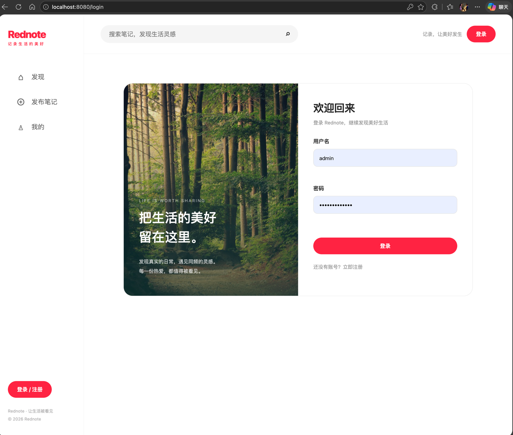
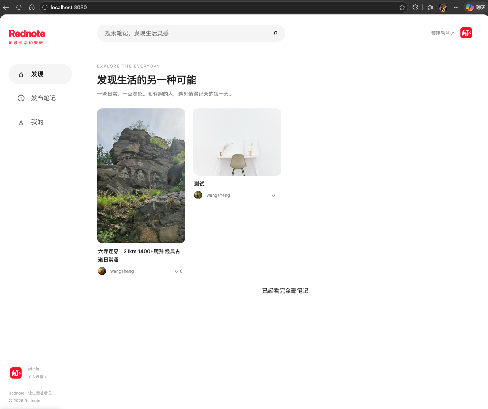
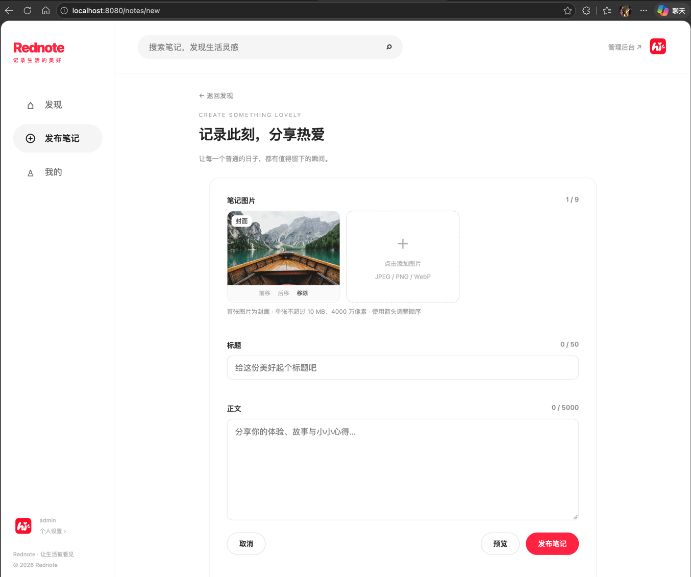
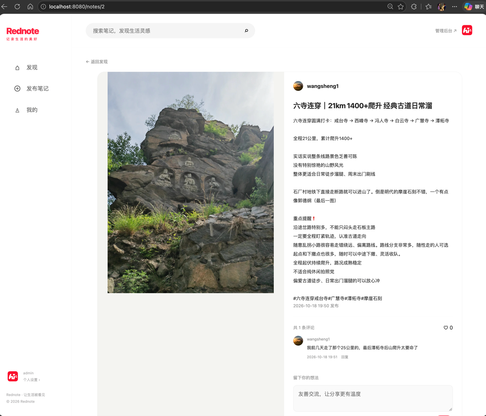
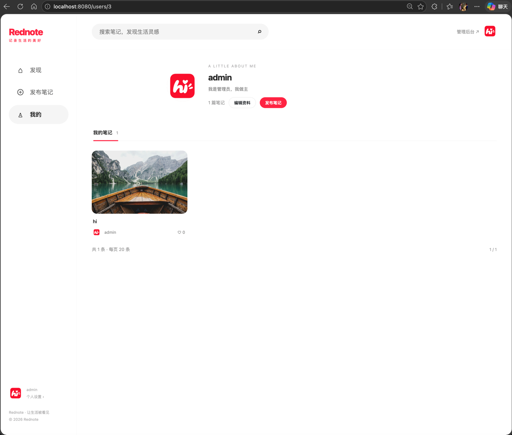
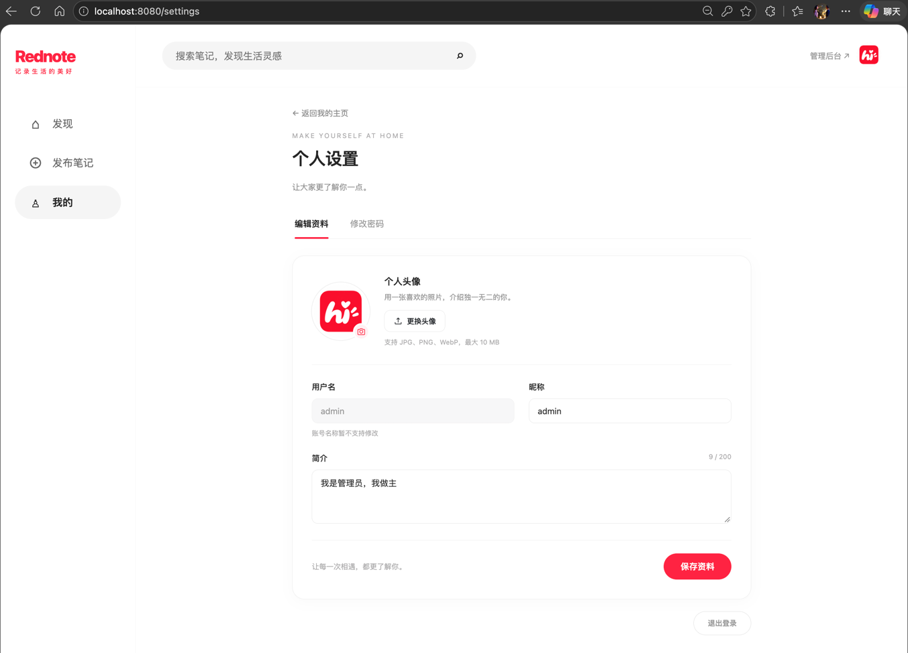
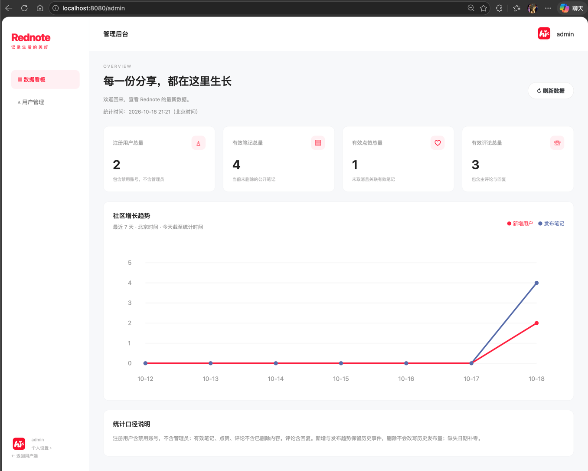

> 下面演示一个完整的SDD开发流程。

最近额度用不完Vibe Coding，Tibo还送了好几张重制卡根本用不完。于是一个下午Vibe Coding了一个mini版的小红书；我是用的模型是GPT 6.1 Sol low。

开发模式使用的是SDD（Specification-Driven-Development），规范驱动开发，也就是先写规范再开发代码，之后都是对规范的维护，而不是对代码的维护。

我开源了这部分代码 https://github.com/wsliture/Rednote-v1.0/

其中
- 前端合计25个文件，4530行代码
- 后端合计44个文件，3137行代码
- 规范(md)文件12个，2507行

代码规模适中，整个系统开发完花了一个下午大约8个小时。系统功能一次性过，没有在对话框里面不断的反复修改的过程。整个开发体验还是很好的。

下面是整个系统的部分截图，然后展示整个SDD的开发流程。

## 1. 系统演示

登陆与注册页面。


主页。


发布笔记。


笔记详情。


个人主页。


编辑资料。


后台管理。


## 2. SDD开发流程

这里演示SDD的一个标准流程：如何从 需求分析 -> 架构设计 -> 原型设计 -> 前端开发 -> 数据库设计 -> 后端开发联调 -> 验收测试

### 2.1 需求分析
首先明确自己想要开发什么样的功能。这里脑海里大致有一个功能。然后扔给大模型生成 `产品需求文档（Product Requirement Document，PRD）`

提示词
```markdown
现在我要进行需求分析，我想要开发一个小红书（Rednote v1.0），它包括如下功能：
* 用户模块
  * 注册功能
  * 登录功能
  * 信息管理：修改个人资料、修改密码、分页展示笔记
* 笔记模块
  * 发布功能
  * 查询功能
  * 编辑功能
  * 删除功能
* 文件服务器
  * 上传图片
  * 删除图片
* 首页模块
  * 瀑布流展示笔记
  * 搜索笔记
* 点赞模块
  * 执行点赞
  * 取消点赞
* 评论模块
  * 增加评论
  * 删除评论
  * 回复评论
  * 删除回复
* 后台管理模块
  * 数据看板
  * 用户管理
请帮我形成一份产品需求文档（PRD）放在 docs/prd.md，如果还有什么不确定的，可以问我
```

### 2.2 架构设计
由于我目前已经有了一些基础知识了，了解了一些Java全栈开发单体应用的背景知识。所以我直接用下面提示此让模型产出 `架构设计文档`。`注意：要让模型参考之前生成的PRD`

（由于功能什么的不是特复杂，就采用比较简单的技术了，复杂的技术也一样的方式进行SDD即可）

```markdown
现在我要做rednote v1.0.0的架构设计，目前设计为一个单体项目。采用三层架构：
表现层（Web层）：采用Thymeleaf作为HTML模板引擎，Bootstrap框架构建响应式页面
业务逻辑层：采用Springboot + SpringMVC + Spring Security
数据访问层：Spring Data JPA + Mysql + 本地文件存储
请同时参考 docs/prd.md 帮我形成一份架构说明文档，放在 docs/arch.md，如果还有什么不清楚请问我
```

对于没有相关技术背景的可以把 PRD 扔给大模型，让大模型去直接生成一套技术架构方案。

好了，提交一下代码。

### 2.3 设计原型

让大模型参考PRD，去生成一份原型。
```markdown
docs/prd.md 这是一份小红书的产品设计文档（PRD），请你依据这个PRD设计界面，要求包括：Web 用户端与 Web 后台管理端，桌面端优先，适配手机。有什么不清楚的可以再问我
```
另外两轮是我这边比较特定的，你可以根据你那边模型生成的原型，自己再交互一下，调一下。

```markdown
请把这里面涉及的所有图片放到原型目录的images目录下，然后原型去引用，另外也可以方便我之后用这些图片进行测试
```

下面这个问题是GPT生成的原型都是用js拼凑起来的HTML，而非纯html页面，这样的方式不便于后续直接修改成可用的前端界面，这里让大模型改一下。
```markdown
另外我看这个原型的html代码很少，几乎所有的布局HTML代码都放到了app.js里面了，之后我想拿给打模型去修改成可用的前端Thymeleaf界面，模型是不是不容易看懂这些产品布局的布局与交互？请问是不是，给我提一些建议
```

```markdown
是不是先要修改一版这个html原型，方便迁移到Thymeleaf。
```

```markdown
好的，就按照这个思路修改一版这个html原型，方便迁移到Thymeleaf。要求界面以及交互逻辑与目前这一版保持不变。如果还有什么不清楚的可以问我。
```

改了一轮，原型体验下来感觉很不错。生成的原型在这里：https://github.com/wsliture/Rednote-v1.0/tree/main/docs/prototype

让它产出一份原型设计spec，这份spec可以指导前端程序员改成可用的界面。
```markdown
好的，按照你的这份原型设计帮我把原型设计整理为一份spec，包括所有的页面设计，交互逻辑，Thymeleaf迁移指南，方便给前端工程师使用（同时也便于前端工程师Agent阅读检索），整理后的文档放在docs/prototype.md，如果还有什么不清楚的可以问我。
```
好了，提交一下代码。

### 2.4 前端开发

根据刚才的原型设计，开发前端代码了。
```markdown
你是一位顶尖的前端开发工程师，同时精通前端页面原型的设计和HTML转Thymeleaf的设计与实现。 docs/prd.md 这是当前项目小红书（Rednote）的产品需求说明书， docs/prototype.md 这是当前项目的产品原型设计说明书，其中产品原型在 docs/prototype/ 目录。请你读取产品说明书和原型设计说明书，必要的时候浏览原型设计页面，然后将该原型转换为当前项目下的模块化的Thymeleaf和前端代码。前端的技术要求可以参考 docs/arch.md。如果还有什么不清楚的可以问我。
```
然后生成完了，改了两轮界面，下面是我这边特定的，你可以忽略，按照你那边的结果去调一下即可。

```markdown
[截图] 左边这个是不是应该再靠左边一些，与上下面对齐，右边的为什么有多个“暂无评论...”，下面文本框应该与上面的文字有一些边距更好一些，总之改得更加优雅一些。如果有什么不清楚的再问我
```

```markdown
[截图] “课程项目 预览环境”，以及右侧肩头指的地方似乎没必要出现，可以删掉。请帮我改的优雅一些。另外浏览所有整个页面，看看是否仍然存在这样的“预览环境”，“测试”等字样，都删掉。
```

```markdown
[截图1] [截图2] 用户管理界面这个箭头指的地方下箭头不美观，帮我改一下改得更加优雅。图2，移动端“欢迎回来”被遮盖住了，帮我修改一下。
```

好了，满意了，提交一下代码。

### 2.5 数据库设计

把之前的prd，架构设计，前端设计（接口契约）扔给大模型，让大模型产出数据库设计文档。
```markdown
现在请为当前小红书（Rednote）项目设计数据库。你可以参考的文档有:  docs/prd.md 是产品需求说明书， docs/arch.md 为系统的架构设计说明  docs/frontend.md 是系统的前端设计包括接口契约。设计好数据库后，把内容写入 docs/database-design.md，如果还有什么不清楚的可以问我。
```

好了，提交代码。

### 2.6 后端开发

把PRD，架构设计，前端设计，数据库设计文档扔给大模型，让大模型开发后端代码。
```markdown
现在你是一个优秀的高级Java后端工程师，熟悉Springboot全家桶以及Thymeleaf全栈。现在我要求你实现当前项目小红书（Readnote）的后端所有的服务，你可以参考 docs/prd.md 产品需求说明书，prd里详细描述了整个系统要实现的功能需求及其它需求。 docs/arch.md 架构说明书，架构说明书里详细描述了整个系统的架构，应该使用什么样的技术栈，请按照架构说明书里的描述按照springboot三层的架构实现整个后端。 docs/frontend.md 前端说明书里面描述了一些接口契约，你可以参考一下方便后续进行前后端联调。 docs/database-design.md 数据库设计文档里面描述了数据库是如何设计的，请参考这个文档完成JPA相关的数据库功能实现。最后整个项目初期为了完成前端页面Thymeleaf的功能验证，实现了一部分preview的后端功能，该后端功能的数据没有接入到后端数据库服务，所以这些代码你需要完全抛弃，重新完成数据库和本地文件存储的接入，最后能够生产可用而非仅仅preview。如果还有什么不清楚的可以问我。
```

一次过，没想到。功能都正常。

提交代码。

### 2.6 验收测试

接下来就是界面上体验一下，发现界面哪里有不对齐，界面哪里不优雅，就截图让模型改一下就可以了。

我体验下来，改的次数很少。


